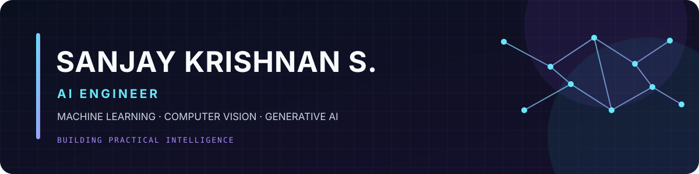

<table>
<tr>
<td width="58%" valign="top">

--> About Me
AI Engineer interested in turning AI research into useful products — from computer vision and machine learning to LLM-powered automation.
- 🔭 Building practical AI applications
- 🧠 Exploring Computer Vision, RAG & AI Agents
- 📄 Peer-reviewed publication in explainable AI
</td>
<td width="42%" valign="top">

--> At a Glance
Focus	
Core	Python · SQL
AI/ML	YOLO · PyTorch
GenAI	LLMs · RAG
Building	APIs · AI apps

</td>
</tr>
</table>

--> Tech Stack

  
  
  
  
  

--> Selected Projects
<table>
<tr>
<td width="50%" valign="top">

--> Smart Waste AI
Computer vision pipeline for classifying Plastic, Paper, Metal and General Waste.

YOLO Python OpenCV
</td>
<td width="50%" valign="top">

--> Grant Automation
LLM-powered workflow to help automate grant discovery and application tasks.

LLMs LangChain Playwright
</td>
</tr>
<tr>
<td width="50%" valign="top">

--> AI Construction Inspection
AI-assisted inspection workflow designed to support construction monitoring.

Computer Vision AI
</td>
<td width="50%" valign="top">

--> Personal AI Tracker
Personal tracking and recommendation app covering 7+ lifestyle metrics.

Python AI Data Analysis
</td>
</tr>
</table>

--> GitHub Dashboard

Curious mind. Practical AI. Continuous learning.

