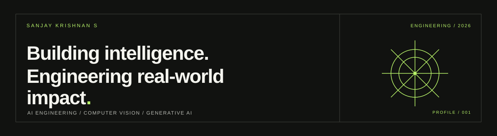

  

  

  <a href="https://sanjaykrishnan.vercel.app">PORTFOLIO</a>
  &nbsp; / &nbsp;
  <a href="https://www.linkedin.com/in/sanjaykrishnanai">LINKEDIN</a>
  &nbsp; / &nbsp;
  <a href="mailto:sanjaykrishnan437@gmail.com">EMAIL</a>

---

## 01 / PROFILE

AI & Data Science engineer interested in building practical AI applications across computer vision, machine learning, generative AI, automation, and connected systems.

- Building AI-powered applications and intelligent automation workflows.
- Exploring computer vision, LLM applications, RAG, and AI agents.
- Interested in backend engineering, IoT, and edge AI applications.
- Focused on turning technical ideas into useful software products.

## 02 / SELECTED WORK

### 01 — Waste Detection & Classification

Worked on a YOLO-based waste detection/classification project for four categories: **Plastic, Paper, Metal, and General Waste**.

- Captured videos of waste and extracted frames at one frame per second for dataset preparation.
- Prepared annotated image data for model training.
- Previously reported performance in the **87–92% range**; the exact metric should be verified before presenting it as a formal accuracy result.

**Technologies:** Python · YOLO · Computer Vision

### 02 — Grant Applier AI Automation

Built an AI-assisted workflow for grant discovery and application-related tasks.

- Worked with LLM-based workflow orchestration.
- Used browser automation to support application workflows.

**Technologies:** LangChain · LangGraph · Playwright · LLMs

### 03 — AI Construction Inspection

Developed an AI-powered application for construction inspection workflows.

- Supported inspection reporting, image analysis, and progress monitoring.
- Structured workflows around inspection, review, assignment, and verification.

**Technologies:** AI applications · Image analysis · Workflow automation

### 04 — Personal AI Tracker

Built a personalized tracking application for lifestyle metrics and daily activities.

- Tracked **7+ lifestyle metrics**.
- Integrated Qwen2.5-7B-Instruct through the Hugging Face API for personalized insights.

**Technologies:** Python · Hugging Face · LLM integration

Explore more on my [portfolio](https://sanjaykrishnan.vercel.app).

## 03 / TECHNICAL TOOLKIT

**Languages**  
Python · SQL · Java · JavaScript · TypeScript

**Machine Learning & Computer Vision**  
PyTorch · TensorFlow · Scikit-learn · YOLO · OpenCV · Pandas · NumPy

**Generative AI**  
LLMs · RAG · Prompt Engineering · AI Agents · LangChain · LangGraph · Hugging Face

**Backend & Databases**  
FastAPI · Node.js · Express.js · PostgreSQL · MySQL · REST APIs

**Platforms & Tools**  
Git · GitHub · Docker · Supabase · Firebase · AWS · Google Cloud

## 04 / RESEARCH

**An Explainable AI-Driven Intelligent Assessment Platform**  
Peer-reviewed publication, IJCREM Journal · April 2026

## 05 / CONNECT

Interested in opportunities involving AI engineering, machine learning, computer vision, and intelligent application development.

[Portfolio](https://sanjaykrishnan.vercel.app) · [LinkedIn](https://www.linkedin.com/in/sanjaykrishnanai) · [Email](mailto:sanjaykrishnan437@gmail.com)

---

  BUILD THOUGHTFULLY. MEASURE HONESTLY. KEEP LEARNING.

